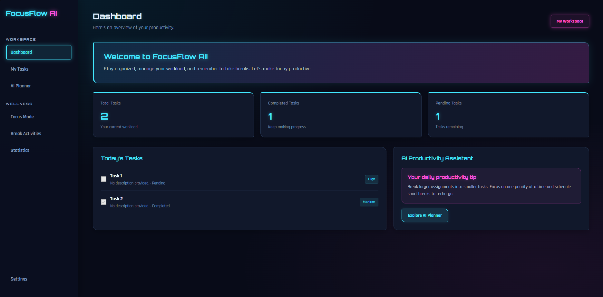
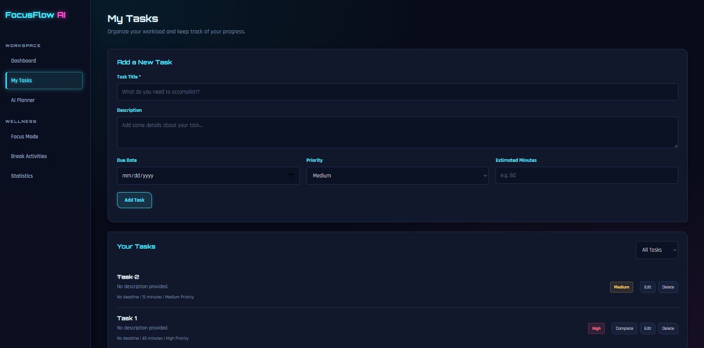
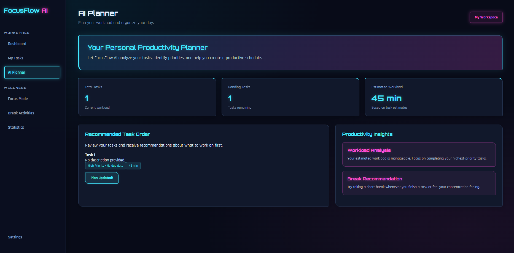
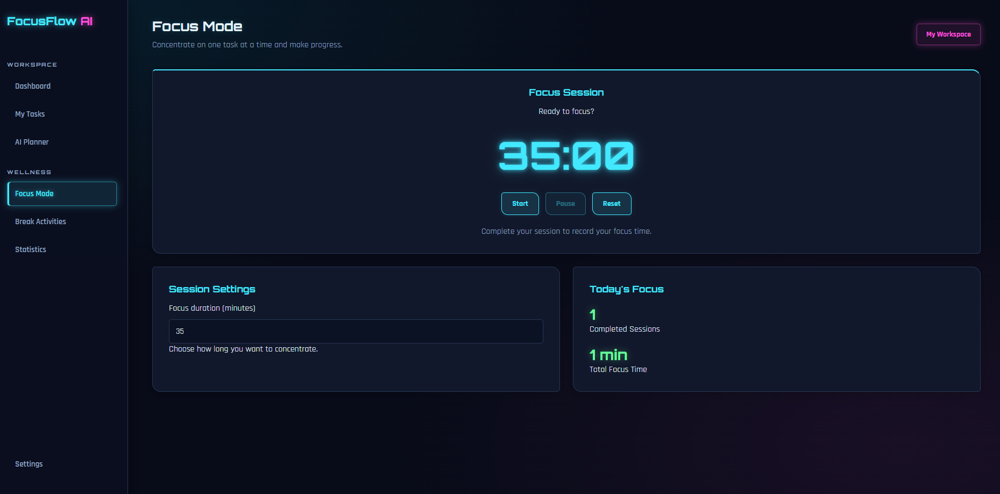
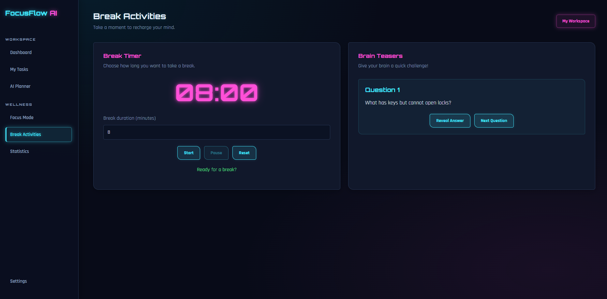
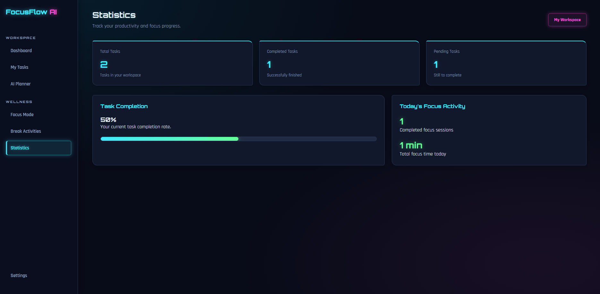
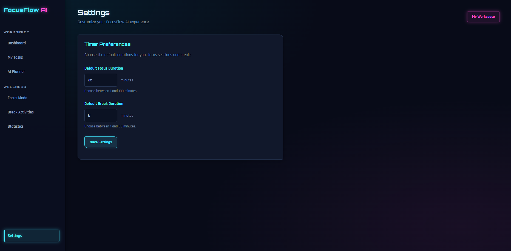

# FocusFlow AI

FocusFlow AI is a productivity and task management web application designed to help users organize their workload, prioritize tasks, manage focus sessions, and maintain productive work habits.

## Features

- **Task Management:** Create, edit, complete, filter, and delete tasks.
- **AI Planner:** Organizes pending tasks using task priorities, due dates, and workload considerations.
- **Focus Mode:** Customizable focus timer with start, pause, and reset controls.
- **Break Activities:** Break timer and interactive brain teasers.
- **Statistics:** View task completion and daily focus-session statistics.
- **Settings:** Customize focus and break durations.
- **Data Persistence:** Stores tasks, focus sessions, and settings using SQLite.
- **Cyberpunk Interface:** Dark theme with neon blue, pink, and green styling.

## Technology Stack

- Python
- Flask
- SQLite
- HTML
- CSS
- JavaScript
- Git and GitHub

## Installation and Setup

1. Clone the repository:

   ```bash
   git clone https://github.com/cedricxu2126/FocusFlow-AI.git
   ```

2. Navigate into the project directory:

   ```bash
   cd FocusFlow-AI
   ```

3. Create a virtual environment:

   ```bash
   python -m venv .venv
   ```

4. Activate the virtual environment on Windows:

   ```powershell
   .\.venv\Scripts\Activate.ps1
   ```

5. Install dependencies:

   ```bash
   pip install -r requirements.txt
   ```

6. Start the application:

   ```bash
   python app.py
   ```

7. Open your browser and visit:

   http://127.0.0.1:5000

## Project Structure

```text
FocusFlow-AI/
├── ai/
│   └── assistant.py
├── database/
│   ├── db.py
│   └── schema.sql
├── routes/
│   ├── tasks.py
│   ├── planner.py
│   ├── focus.py
│   ├── breaks.py
│   ├── statistics.py
│   └── settings.py
├── static/
│   ├── css/
│   └── js/
├── templates/
├── app.py
└── README.md
```

## How the Planner Works

The current planner uses a rule-based algorithm to organize pending tasks. It considers task priority and due-date urgency to generate recommendations and workload insights.

An optional OpenAI integration module is included for potential future expansion. The current application does not require an OpenAI API key or paid API access.

## Database

FocusFlow AI uses SQLite to store tasks, task statuses, priorities, estimated durations, completed focus sessions, and user timer preferences.

The database is initialized automatically when the Flask application starts.

## Future Improvements

- Optional generative AI task recommendations
- Additional productivity analytics
- More customizable break activities
- Sound notifications when timers finish
- Expanded scheduling options

## Application Screenshots

### Dashboard


### Task Management


### AI Planner


### Focus Mode


### Break Activities


### Statistics


### Settings


## Author

Developed as an AI-assisted software development course project.

**GitHub Repository:** https://github.com/cedricxu2126/FocusFlow-AI